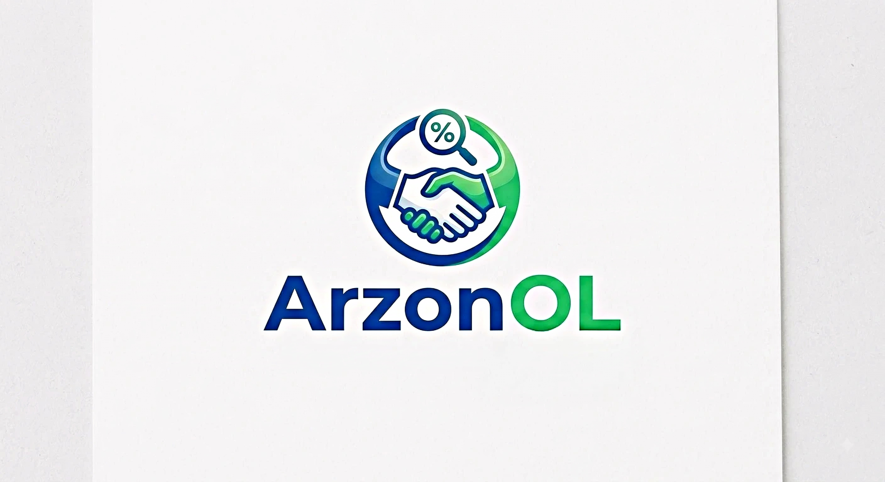

<p align="center">
  
</p>

<h1 align="center">ArzonOL — Narxlar agregatori 💰</h1>

<p align="center">
  <em>O'zbekiston marketpleyslarida mebel, texnika va qurilish materiallari narxlarini solishtirish.</em>
</p>

<p align="center">
  
  
  
  
</p>

---

## 📌 Loyiha haqida

**ArzonOL** — bu aqlli xaridlar uchun platforma. Sayt hech narsa sotmaydi, faqat kerakli tovar qayerda arzonroq ekanini ko'rsatadi va tanlangan do'konga yo'naltiradi.

## ✨ Asosiy imkoniyatlar

- 🔍 **Aqlli qidiruv va solishtirish:** Butun O'zbekiston bo'ylab eng yaxshi takliflarni toping.
- 🔒 **Narxlar maxfiyligi:** Mehmonlar faqat takliflar sonini ko'radi. Narxlarning o'zi va narxlar tarixi **faqat** ro'yxatdan o'tgan foydalanuvchilar uchun mavjud (bu CSS orqali vizual yashirish emas, balki server darajasidagi himoya).
- 📊 **Narxlarni kuzatish:** Tovarlarni o'zingiz xohlagan narx chegarasi bilan saralanganlarga qo'shing.
- 🌍 **Ko'p tillilik:** O'zbek (UZ), Rus (RU) va Ingliz (EN) tillarini qo'llab-quvvatlash.
- 📈 **Kuchli admin panel:** Talab bo'yicha hisobotlar, eng ko'p qidirilgan so'rovlar va hududlar bo'yicha statistika.

---

## 🛠 Texnologiyalar

**Backend:**
- [Python 3.11+](https://www.python.org/)
- [FastAPI](https://fastapi.tiangolo.com/) (`auth`, `scrypt` va sessiyalar bilan ishlashni o'z ichiga oladi)
- [SQLite](https://sqlite.org/index.html)

**Frontend:**
- Vanilla HTML / CSS / JS
- Dizayn uchun zamonaviy CSS-tokenlar

---

## 🚀 O'rnatish va ishga tushirish

Ilovani ishlatish uchun **Python 3.11+** va **Node.js** talab qilinadi (Node.js faqat loyihani Node serveri orqali ishga tushirmoqchi bo'lsangiz kerak bo'ladi).

### 1. Bog'liqliklarni o'rnatish

```bash
pip install fastapi "uvicorn[standard]" "pydantic[email]"
```

### 2. Ma'lumotlar bazasini tayyorlash

`backend` papkasiga o'ting va initsializatsiya skriptlarini ishga tushiring:

```bash
cd backend

# Tovar katalogini yuklash
python seed.py

# Demo-foydalanuvchilar va test faolligini yaratish
python seed_demo.py
```

### 3. Serverni ishga tushirish

FastAPI dagi backend API va frontend statikasini uzatadi (CORS talab qilinmaydi, qo'shimcha serverlar ham kerak emas).

```bash
python -m uvicorn main:app --reload --port 8000
```

Brauzerda quyidagi manzilga o'ting: [http://localhost:8000](http://localhost:8000)

> 📘 **API Hujjatlar (Swagger):** [http://localhost:8000/docs](http://localhost:8000/docs)

---

## 🔑 Demo kirish

| Rol | Email | Parol | Admin panelga kirish |
| :--- | :--- | :--- | :---: |
| **Demo-foydalanuvchi / Admin** | `demo@arzonol.uz` | `demo1234` | ✅ |

Admin panel manzili: [/admin](http://localhost:8000/admin) (faqat `is_admin = 1` bo'lgan hisoblar uchun).

---

## 📁 Loyiha tuzilmasi

```text
├── index.html                  # Asosiy sahifa
├── assets/
│   ├── css/                    # Uslublar va dizayn-tokenlar (:root)
│   ├── js/i18n.js              # Tarjimalar (ru / uz / en)
│   ├── js/data.js              # API mijozi va takliflar hisobi
│   ├── js/app.js               # Render va interfeys mantiqiy qismi
│   └── img/products/           # Tovar rasmlari (lokal saqlanadi)
├── backend/
│   ├── main.py                 # FastAPI: auth, katalog, treking, analitika
│   ├── db.py                   # SQLite sxemasi
│   ├── auth.py                 # Parollar (scrypt) va sessiyalar
│   ├── seed.py                 # assets/js/data.js dan katalogni yuklash
│   └── arzonol.db              # Ma'lumotlar bazasi (avtomatik yaratiladi)
```

---

## 🧠 Arxitektura va xavfsizlik

### Narxlar shlyuzi
Narxlar va tarix faqat avtorizatsiyadan o'tgan foydalanuvchilarga beriladi. Mehmonlar uchun API faqat `offersCount` qaytaradi, shunda frontend kerakli qatorlarni xiralashtirishi (blur) mumkin.
> 🛡️ **Muhim:** Bloklash backend darajasida amalga oshiriladi! Brauzer inspektori xiralashuvni "buzib kirishga" yordam bermaydi, chunki ma'lumotlar javobda umuman yo'q.

### Ma'lumotlar bazasi
- **Foydalanuvchilar va sessiyalar:** `users`, `sessions`
- **Ma'lumotnomalar:** `categories`, `platforms`, `regions`
- **Katalog:** `products`, `product_images`, `offers`, `price_history`
- **Foydalanuvchi faolligi:** `tracked_products`, `compare_items`, `search_queries`, `product_views`

> 💡 **Rasmlar** diskda fayl ko'rinishida yotadi (`assets/img/products/`). Bazada faqat ularning yo'li saqlanadi. BLOB larni SQLite da saqlash so'rovlarni juda sekinlashtirgan bo'lardi.

Katalog `assets/js/data.js` dan yuklanadi, shuning uchun frontend va baza doimo sinxron bo'ladi. `seed.py` skripti idempotent: u katalogni qayta yaratadi, lekin foydalanuvchilarga tegmaydi.

---

## 👤 Shaxsiy kabinet

Bosh qismdagi ism ustiga bosish orqali kirish mumkin. 3 ta sahifani o'z ichiga oladi:
1. **Kuzatish:** Xohlagan narx chegaralariga ega tovarlar.
2. **Tarix:** Ko'rishlar va qidiruv so'rovlari.
3. **Sozlamalar:** Profil va parolni o'zgartirish (parol o'zgarganda boshqa barcha sessiyalar yopiladi).

---

## 🛠 Admin-panel

`/admin` manzilidagi panel batafsil hisobotni ko'rsatadi:
- Foydalanuvchilar va kuzatishlar soni
- Eng ko'p qidirilgan so'rovlar
- Hududlar va kutilayotgan narxlar bo'yicha talab taqsimoti

Ma'lumotlar `GET /api/stats/full` orqali beriladi (admin huquqiga ega bo'lmagan foydalanuvchilarga 403 status qaytariladi).

---

## ⚠️ Muhim eslatma

Saytdagi tovarlar narxi va mavjudligi — **demo ma'lumotlar** va ommaviy ofera hisoblanmaydi. Barcha marketpleys nomlari ularning qonuniy egalariga tegishli.
